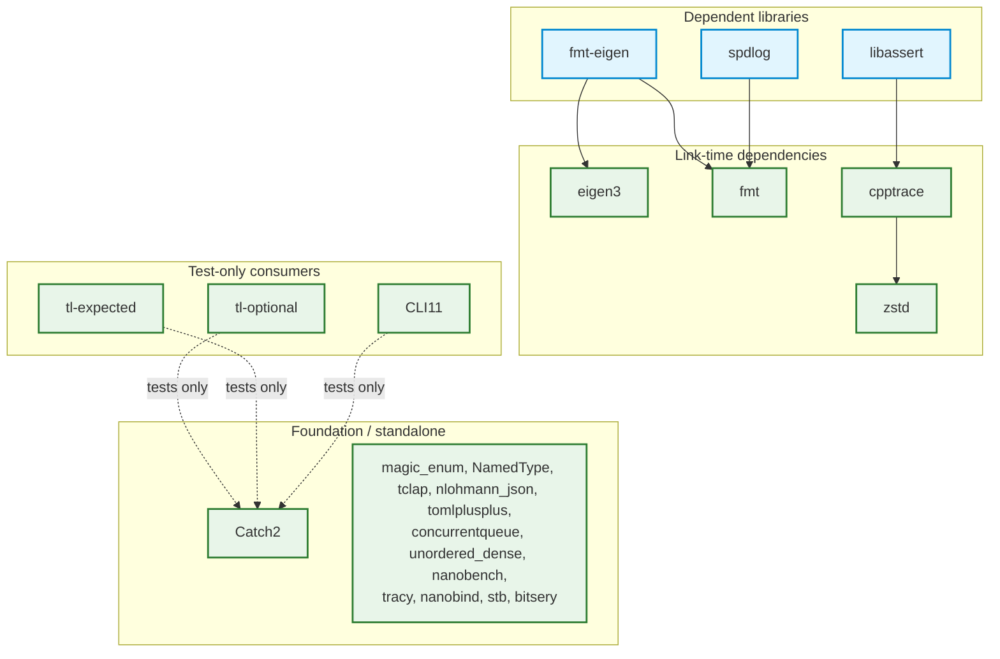

# third_party_base_libs

Eigen, fmt, cpptrace, libassert, magic_enum, Catch2, ... built for every platform

Automated cross-platform build system and CI pipeline recipe for **third-party base C/C++ libraries** (Eigen3, fmt, Catch2, and more), powered by [**csorchestrator**](https://github.com/cscosine/csorchestrator).

---

<!-- cs-template:begin (this block is owned by cs-project-template: do not edit; the rest of the file is the project's) -->
## Getting started

Requires Python 3.11 or newer and Git.

```bash
./setup.sh                    # Windows: .\setup.ps1
source .venv/bin/activate     # Windows: .\.venv\Scripts\Activate.ps1
```

`setup.sh` creates `.venv`, installs the project with its development tools and csorchestrator, and installs the
pre-commit hooks.

csorchestrator: `setup.sh` installs the pinned version (v0.1.2). Another one:
`./setup.sh --csorchestrator=<tag or branch>`; a local clone, editable: `./setup.sh --csorchestrator=../csorchestrator`
(Windows: `.\setup.ps1 -CsOrchestrator <...>`).

Run the recipe locally, regenerate the GitHub workflow after changing it:

```bash
python third_party_base_libs_project.py
python third_party_base_libs_project.py generate-github-workflow
```

Generated files, never edited by hand:

| Path | Made by | |
|---|---|---|
| `.github/workflows/third_party_base_libs.yml` | `third_party_base_libs_project.py generate-github-workflow` | Edit the recipe, then regenerate |
| `csorchestratorsdk/` | csorchestrator, at the same command | The release-manifest helpers the CI runs, without installing csorchestrator |
| `dependencies/` | csorchestrator, at the same command | The manifests and recipes of the releases this project builds on |
| `_csw/` *(git-ignored)* | a local run of `third_party_base_libs_project.py` | Sources, builds, installs, deploy archives; delete it to start clean |

Checks and tests:

```bash
pre-commit run --all-files
pytest                        # --run-all: every test, as CI; --run=<marker>: an opt-in group (tests/conftest.py)
```

The shared files (setup, checks, CI, agent rules) come from
[cs-project-template](https://github.com/cscosine/cs-project-template); to bring them to its latest version, on a
branch: `copier update --defaults`.

## Working in VS Code

`./open-code.sh [filter]` (Windows: `.\open-code.ps1 [filter]`) opens VS Code with the venv active. When the project has
C++ sources of its own (a `CMakeLists.txt` and a `csCMakeProjectSetup.json`), it attaches the window to one of their
builds, made by a local run of the recipe (`python third_party_base_libs_project.py`); before the first build it opens a
Python-only window. Without C++ sources it opens the folder.
The filter is a part of the build folder name or of the compiler (`gcc`, `clang`, `msvc`, `clang-cl`),
needed when there are several builds.

The script writes a **workspace file** for the chosen build, `<build>/third_party_base_libs.code-workspace`, and opens it
(not the folder): it holds the build's settings (build folder, configurations, IntelliSense, debugger). The window title
shows `third_party_base_libs - <build>`. To come back: run the script again, or File > Open Recent and pick that
workspace. Opening the folder itself (`code .`) gives a window without the build: CMake Tools would ask for a kit and
configure a new build of its own. Each build has its own workspace file and window, so gcc and clang can be open side
by side. The builds are found from the csCMake layout of `csCMakeProjectSetup.json`; CMake is the one that made the
build (its path is in the build's `CMakeCache.txt`).

Needs VS Code with its `code` command on the PATH (the Linux packages and the Windows installer add it; otherwise the
script says which file to open by hand) and, on Linux, gdb to debug.

The first time in a window (VS Code remembers it):

1. CMake Tools asks "Select a kit": pick **`[Unspecified]`**, the build keeps its own compiler. CMake Tools then
   configures (Output, CMake).
2. Linux: clangd asks to install itself, or to disable the other IntelliSense: yes. Windows (Visual Studio builds):
   nothing to do, IntelliSense comes from CMake Tools.

Every day:

- The configuration (those of the build) and Build (F7): the status bar.
- Tests: the Testing view (Catch2: one entry per test case), run or debug one.
- The launch target (status bar): Run and Debug, "Debug the launch target" (F5, it builds first); with Catch2 also
  "Debug the launch target (Catch2 test spec)" (a test name or a `[tag]`).
- Install (for the next libraries, the deployments): command palette, "CMake: Install".
<!-- cs-template:end -->

## Overview

Building cross-platform third-party C/C++ libraries from source across multiple platforms (Linux, Windows and macOS) and architectures (`x64` and `arm64`) can be complex and error-prone. **third_party_base_libs** defines a declarative build and packaging recipe in Python using the `csorchestrator` framework.

With this setup:
- The build pipeline, dependencies, and repository list are defined in Python code.
- Cross-platform CI workflows (e.g. [`.github/workflows/third_party_base_libs.yml`](.github/workflows/third_party_base_libs.yml)) are automatically generated.
- Build artifacts, manifests, and release archives (`.tar.gz` bundles) are assembled consistently across environments.

---

## Architecture & Build Pipeline

The core build recipe is defined in [`third_party_base_libs_project.py`](third_party_base_libs_project.py) and executes across the matrix generated by `csorchestrator`.

### Version Alignment

The project version (`0.1.1`) is defined both in [`third_party_base_libs_project.py`](third_party_base_libs_project.py) (`create_default_orchestrator(version=...)`) and in [`pyproject.toml`](pyproject.toml) — keep the two aligned when bumping the version.

### Execution Phases

1. **Repos Self Checkout & Update**:
   - Performs a shallow (`depth=1`) self-checkout of this repository so release assembly runs on the runner.
   - Downloads the csCMake release package pinned in [`third_party_base_libs_project.py`](third_party_base_libs_project.py) (`cscmake_version`, e.g. `1.0.0-rc8`) and unpacks it into `_csw/csCMake`, where the presets of the libraries find it (sibling layout).
2. **Checkout & Build each library**: for every repository configured in [`third_party_base_libs_project.py`](third_party_base_libs_project.py):
   - Clones or pulls the repository into `_csw/<repo>` at the configured ref (a tag of each library).
   - Configures, builds, and installs the library into `_csw/install/<variant>/<repo>` using the per-repository `BuildConfig` (e.g. `RELEASE`, `DEBUG_RELEASE`).
3. **Get Versions**:
   - Reads each installed library's package version (CMakeConfig package) and writes a per-variant `.csorchestratorManifest`.
4. **Create Archives**:
   - Packages the installed outputs into per-variant `.tar.gz` archives together with the matching manifest.
5. **Artifacts & Release Bundling**:
   - Uploads per-variant artifacts, then `release-from-artifacts` merges them into a single `third_party_base_libs-<version>.csorchestratorManifest` and `third_party_base_libs-<version>-bundle.tar.gz` for the GitHub Release.

### Included Libraries

Each library is built from `cscosine/<repo>`, pinned in [`third_party_base_libs_project.py`](third_party_base_libs_project.py)
(a tag once a release of this project built it). Most are forks: `main` is an upstream release (stb: upstream
`master`, it has no releases) plus our commits, one per reason (the csCMake presets, tests offline or off, compiler
fixes), listed in the fork's `cscosine/README.md`; tags `v<upstream>-cs.<n>`; syncing with a new upstream release: the
`cs-fork-sync` skill. fmt-eigen, tclap and NamedType are copies of our own (upstream inactive) and stb a package of
ours around upstream headers: they carry versions of our own. Our fixes stay ours (no pull requests upstream). The
version below is the one of the installed CMake package.

| Repository | Version | Upstream | Licence | Kind | BuildConfig |
|---|---|---|---|---|---|
| eigen3 | 5.0.1 | [libeigen/eigen](https://gitlab.com/libeigen/eigen) | MPL-2.0 | header-only | `RELEASE` |
| fmt | 12.2.1 | [fmtlib/fmt](https://github.com/fmtlib/fmt) | MIT | compiled | `DEBUG_RELEASE` |
| fmt-eigen | 1.0.0 | (no releases; author Yunfan REN) | MIT | header-only | `RELEASE` |
| zstd | 1.6.0 | [facebook/zstd](https://github.com/facebook/zstd) | BSD-3-Clause | compiled (static) | `DEBUG_RELEASE` |
| cpptrace | 1.0.4 | [jeremy-rifkin/cpptrace](https://github.com/jeremy-rifkin/cpptrace) | MIT | compiled | `DEBUG_RELEASE` |
| libassert | 2.2.1 | [jeremy-rifkin/libassert](https://github.com/jeremy-rifkin/libassert) | MIT | compiled | `DEBUG_RELEASE` |
| magic_enum | 0.10.0 | [Neargye/magic_enum](https://github.com/Neargye/magic_enum) | MIT | header-only | `DEBUG_RELEASE` |
| Catch2 | 3.16.1 | [catchorg/Catch2](https://github.com/catchorg/Catch2) | BSL-1.0 | compiled | `DEBUG_RELEASE` |
| tclap | 1.0.0 | (SourceForge; version of our own) | MIT | header-only | `RELEASE` |
| NamedType | 1.1.0 | [joboccara/NamedType](https://github.com/joboccara/NamedType) | MIT | header-only | `RELEASE` |
| tl-optional | 1.1.0 | [TartanLlama/optional](https://github.com/TartanLlama/optional) | CC0-1.0 | header-only | `RELEASE` |
| tl-expected | 1.3.1 | [TartanLlama/expected](https://github.com/TartanLlama/expected) | CC0-1.0 | header-only | `RELEASE` |
| nlohmann_json | 3.12.0 | [nlohmann/json](https://github.com/nlohmann/json) | MIT | header-only | `RELEASE` |
| tomlplusplus | 3.5.1 | [marzer/tomlplusplus](https://github.com/marzer/tomlplusplus) | MIT | header-only | `RELEASE` |
| CLI11 | 2.7.2 | [CLIUtils/CLI11](https://github.com/CLIUtils/CLI11) | BSD-3-Clause | header-only | `RELEASE` |
| concurrentqueue | 1.0.5 | [cameron314/concurrentqueue](https://github.com/cameron314/concurrentqueue) | BSD-2-Clause / BSL-1.0 | header-only | `RELEASE` |
| unordered_dense | 5.3.3 | [martinus/unordered_dense](https://github.com/martinus/unordered_dense) | MIT | header-only | `RELEASE` |
| nanobench | 4.6.0 | [martinus/nanobench](https://github.com/martinus/nanobench) | MIT | header-only | `RELEASE` |
| spdlog | 1.17.0 | [gabime/spdlog](https://github.com/gabime/spdlog) | MIT | compiled | `DEBUG_RELEASE` |
| tracy | 0.15.0 | [wolfpld/tracy](https://github.com/wolfpld/tracy) | BSD-3-Clause | compiled (client) | `DEBUG_RELEASE` |
| nanobind | 3.1.0 | [wjakob/nanobind](https://github.com/wjakob/nanobind) | BSD-3-Clause | sources + CMake | `RELEASE` |
| stb | 1.0.0 | [nothings/stb](https://github.com/nothings/stb) (version of our own) | MIT / public domain | header-only | `RELEASE` |
| bitsery | 5.2.5 | [fraillt/bitsery](https://github.com/fraillt/bitsery) | MIT | header-only | `RELEASE` |

What we build and what we leave to upstream:

- **Configurations**: Debug and Release only (`DEBUG_RELEASE` for the compiled libraries, `RELEASE` for the header-only
  ones). The other configurations of the csCMake projects (e.g. paranoid, sanitizers) are theirs: they link the
  Release or Debug build of these libraries.
- **Compiled forks**: position independent code (linked into shared libraries) and the Debug postfix `d`, set in each
  fork (its `csCMakeProjectSetup.json` or its own options); macOS 13.3 as deployment target, recorded in the package
  (`share/cscmake/`).
- **Tests**: upstream's tests run where they build offline (with the Catch2 of this project, no downloads), off
  otherwise (nlohmann_json, nanobind); none of ours, except the smoke test of the stb package. Build warnings, header
  self-containment and the code are upstream's.
- **Notes per library**: spdlog on our fmt (`SPDLOG_FMT_EXTERNAL`); tracy: the client library only
  (`Tracy::TracyClient`, profiling on demand), the viewer is the upstream release of the same version (the protocol
  must match); nanobind: the package is its headers, sources and `nanobind-config.cmake`, compiled by the consumer,
  which calls `find_package(Python … Development.Module)` first (its `ext/robin_map` is vendored in the fork:
  csorchestrator does not clone submodules); stb: `stb::stb` with `stb_image.h` and `stb_image_write.h` only, one
  source of the consumer defines the `*_IMPLEMENTATION` macros; bitsery rather than zpp_bits (C++20).

### Library Dependency Graph

The graph below captures the **actual compile / link-time dependencies** between the libraries,
derived from each repository's `CMakeLists.txt` and the installed CMake package configs
(`*Config.cmake` / `*Targets.cmake`) produced by the build.



**Edge legend:**

| Edge | Kind | Evidence |
|---|---|---|
| `fmt-eigen` → `eigen3` | link | [`_csw/fmt-eigen/fmt-eigen/CMakeLists.txt`](_csw/fmt-eigen/fmt-eigen/CMakeLists.txt): `cs_find_package(... Eigen3 REQUIRED CONFIG)`, links `Eigen3::Eigen` |
| `fmt-eigen` → `fmt` | link | same file: `cs_find_package(... fmt REQUIRED CONFIG)`, links `fmt::fmt`; re-declared via `find_dependency(fmt)` in `fmt-eigenConfig.cmake` |
| `libassert` → `cpptrace` | link | [`_csw/libassert/CMakeLists.txt`](_csw/libassert/CMakeLists.txt): `target_link_libraries(... PUBLIC cpptrace::cpptrace)`, the cpptrace package of this recipe (`LIBASSERT_USE_EXTERNAL_CPPTRACE` `ON` in the fork: libassert installs itself only, not a copy of cpptrace); exported as `find_dependency(cpptrace REQUIRED)` in `libassert-config.cmake` |
| `spdlog` → `fmt` | link | the spdlog fork: `SPDLOG_FMT_EXTERNAL` `ON`, links `fmt::fmt`; `find_dependency(fmt)` in `spdlogConfig.cmake` |
| `cpptrace` → `zstd` | link | the cpptrace fork: `CPPTRACE_USE_EXTERNAL_ZSTD` `ON`, cpptrace and the libdwarf it builds use the zstd package of this recipe; its package config finds `zstd` |
| `CLI11` → `Catch2` | **tests only** | the CLI11 tests on the Catch2 package (offline) |
| `tl-optional` → `Catch2` | **tests only** | [`_csw/tl-optional/CMakeLists.txt`](_csw/tl-optional/CMakeLists.txt): `find_package(Catch2 3 REQUIRED CONFIG)` |
| `tl-expected` → `Catch2` | **tests only** | [`_csw/tl-expected/CMakeLists.txt`](_csw/tl-expected/CMakeLists.txt): `find_package(Catch2 3 REQUIRED CONFIG)` |

**Notes:**

- **Leaf / foundation libraries** (every library outside the "Dependent libraries" group, `cpptrace` apart: it links `zstd`) have no dependencies on any of the other libraries in this recipe.
- **`csCMake` is intentionally not in the graph**: it is build *tooling* used by the `csCMake`-based repos (`fmt-eigen`, `tclap`) at **configure time** via their `cs_*` macros — it is the release package unpacked in `_csw/csCMake`, not built, and it is **not** a runtime / install-time dependency of any installed library.
- **`magic_enum` is not an actual dependency of `libassert` in this build.** It is only an *optional, compile-time enhancement* (better enum printing in assertion diagnostics) guarded by `LIBASSERT_USE_MAGIC_ENUM` in [`_csw/libassert/include/libassert/stringification.hpp`](_csw/libassert/include/libassert/stringification.hpp). That macro is only enabled when libassert's tests are built, which is **off** here — the installed `libassert-config.cmake` wraps it in `if(OFF)` and `libassert-targets.cmake` links only `cpptrace::cpptrace`. `cpptrace` itself has **no** reference to `magic_enum` anywhere in its source tree or installed config.
- `cpptrace` builds `libdwarf` (pinned, `FetchContent` at configure: the network is needed at configure) on the `zstd` package of this recipe and installs it, static, in its package; libdwarf links the **zlib of the system**: the consumers of cpptrace / libassert need `zlib1g-dev` on Linux (macOS: the system zlib; Windows: no libdwarf, `dbghelp`). The other system libraries of the packages: `dl` (Linux). No Homebrew, no absolute paths.
- Test-only copies inside upstream sources, not shipped: fmt `test/gtest`, magic_enum `test/3rdparty/doctest`.
- Compiled libraries (static): `fmt`, `zstd`, `cpptrace`, `libassert`, `Catch2`, `spdlog`, `tracy`. The others are header-only (nanobind: sources compiled by the consumer).

---

## Supported Build Matrix

The target execution matrix: the `csorchestrator` default matrix used in `create_default_orchestrator()` (Ubuntu
22.04 / 24.04, Windows), plus the opt-in variants of `additional_matrix_list` in
[`third_party_base_libs_project.py`](third_party_base_libs_project.py) (Ubuntu 26.04, macOS 15 / 26):

| OS | Version | Architecture | Compiler | Generator |
|---|---|---|---|---|
| **Linux** | Ubuntu 22.04 | `x64` | GCC (default) | Ninja Multi-Config |
| **Linux** | Ubuntu 22.04 | `x64` | Clang (default) | Ninja Multi-Config |
| **Linux** | Ubuntu 22.04 | `arm64` | GCC (default) | Ninja |
| **Linux** | Ubuntu 22.04 | `arm64` | Clang (default) | Ninja |
| **Linux** | Ubuntu 24.04 | `x64` | GCC (default) | Ninja Multi-Config |
| **Linux** | Ubuntu 24.04 | `x64` | Clang (default) | Ninja Multi-Config |
| **Linux** | Ubuntu 24.04 | `arm64` | GCC (default) | Ninja |
| **Linux** | Ubuntu 24.04 | `arm64` | Clang (default) | Ninja |
| **Linux** | Ubuntu 26.04 | `x64` | GCC (default) | Ninja Multi-Config |
| **Linux** | Ubuntu 26.04 | `x64` | Clang (default) | Ninja Multi-Config |
| **Linux** | Ubuntu 26.04 | `arm64` | GCC (default) | Ninja |
| **Linux** | Ubuntu 26.04 | `arm64` | Clang (default) | Ninja |
| **macOS** | macOS 15 | `arm64` | Apple Clang | Ninja Multi-Config |
| **macOS** | macOS 15 | `arm64` | Apple Clang | Xcode |
| **macOS** | macOS 26 | `arm64` | Apple Clang | Ninja Multi-Config |
| **macOS** | macOS 26 | `arm64` | Apple Clang | Xcode |
| **Windows** | Windows 10 | `x64` | MSVC 2022 (v17) | Visual Studio 17 2022 |
| **Windows** | Windows 10 | `x64` | MSVC 2026 (v18) | Visual Studio 18 2026 |
| **Windows** | Windows 10 | `x64` | MSVC-Clang (v17) | Visual Studio 17 2022 |
| **Windows** | Windows 10 | `x64` | MSVC-Clang (v18) | Visual Studio 18 2026 |

macOS: the binaries run on macOS 13.3 and newer (`CMAKE_OSX_DEPLOYMENT_TARGET` of the csCMake presets); the runners
of Ubuntu 26.04 (`ubuntu-26.04`, `ubuntu-26.04-arm`) are newer than the actionlint release of pre-commit:
[`.github/actionlint.yaml`](.github/actionlint.yaml).

---

## Repository Structure

```
third_party_base_libs/
├── .claude/skills/
│   └── third_party_base_libs-orchestrator-recipe/ # Agent skill for auditing recipes & re-generating workflows
├── third_party_base_libs_project.py                       # Main orchestrator pipeline recipe (source of truth)
├── pyproject.toml                            # Project packaging, Ruff, MyPy, and Pytest configuration
├── setup.sh / setup.ps1                      # Environment bootstrap scripts (Linux / Windows)
├── open-code.sh / open-code.ps1              # Helper scripts to launch VS Code inside the virtualenv
├── .pre-commit-config.yaml                   # Pre-commit checks (Ruff, MyPy, Actionlint)
├── third_party_base_libs/
│   └── csorchestrator_config.py             # Toolchain and compiler mapping logic (included in release)
├── csorchestratorsdk/portable/               # [Autogenerated / Vendored] Standalone SDK synced from csorchestrator
├── tests/
│   └── third_party_base_libs/               # Placeholder tests for configuration mappings (extend later)
└── .github/workflows/
    └── third_party_base_libs.yml                  # [Autogenerated] GitHub Actions CI workflow (emitted by third_party_base_libs_project.py)
```

## Agent Skills

This repository includes a project-specific agent skill under [`.claude/skills/`](.claude/skills/), where Claude Code finds it:

* [**`third_party_base_libs-orchestrator-recipe`**](.claude/skills/third_party_base_libs-orchestrator-recipe/SKILL.md): Guides AI coding assistants in auditing recipe consistency (checking that extra files exist, verifying version and repository-list alignment), re-generating the GitHub Actions workflow (`./third_party_base_libs_project.py generate-github-workflow`), and running pre-commit quality checks.

### How to Use the Skill

* **Automatic Activation (Natural Language)**: Claude Code loads the skills of `.claude/skills/` and follows this one when given relevant prompts, such as:
  * *"Audit the third_party_base_libs recipe consistency"*
  * *"Add a new library to the recipe and re-generate the workflow"*
  * *"Add a new build variant to the matrix"*
* **Explicit Invocation**: Prompt the assistant directly:
  * *"Use the `third_party_base_libs-orchestrator-recipe` skill to audit the build recipe"*
* **Human Developer Runbook (Standard Operating Procedure / SOP)**: For manual work without an AI assistant, [`.claude/skills/third_party_base_libs-orchestrator-recipe/SKILL.md`](.claude/skills/third_party_base_libs-orchestrator-recipe/SKILL.md) serves as a concise checklist for extra files, version alignment, and workflow re-generation commands.

---

## License

This project is licensed under the [MIT License](LICENSE).
