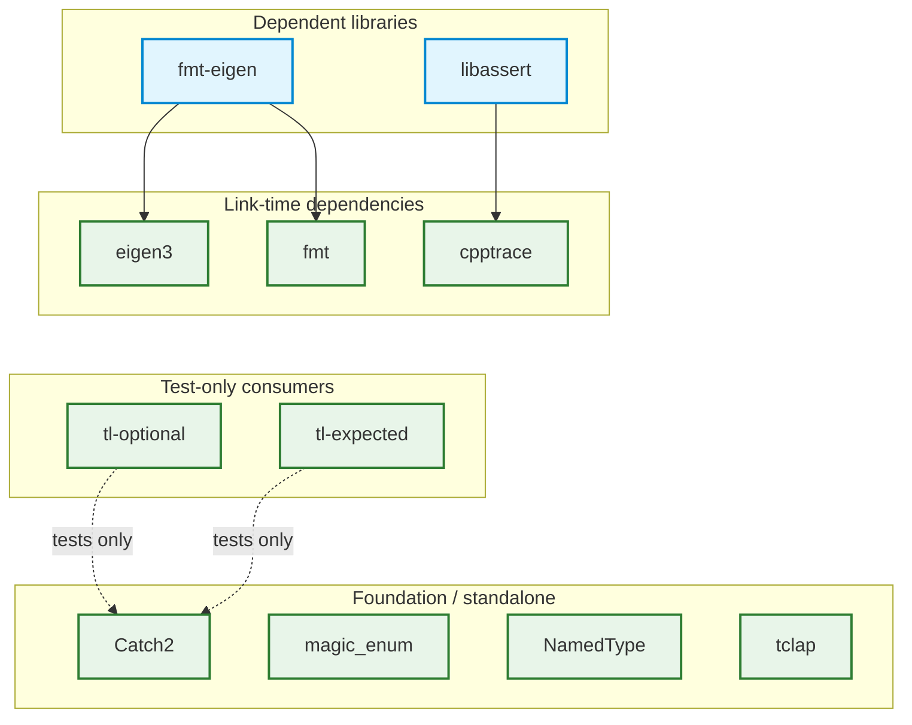

# third_party_base_libs

Eigen, fmt, cpptrace, libassert, magic_enum, Catch2, ... built for every platform

Automated cross-platform build system and CI pipeline recipe for **third-party base C/C++ libraries** (Eigen3, fmt, Catch2, and more), powered by [**csorchestrator**](https://github.com/cscosine/csorchestrator).

---

<!-- cs-template:begin (this block is owned by cs-project-template: do not edit; the rest of the file is the project's) -->
## Getting started

Requires Python 3.11 or newer and Git.

```bash
./setup.sh                    # Windows: .\setup.ps1
source .venv/bin/activate     # Windows: .\.venv\Scripts\Activate.ps1
```

`setup.sh` creates `.venv`, installs the project with its development tools and csorchestrator, and installs the
pre-commit hooks.

csorchestrator: `setup.sh` installs the pinned version (v0.1.0-rc1). Another one:
`./setup.sh --csorchestrator=<tag or branch>`; a local clone, editable: `./setup.sh --csorchestrator=../csorchestrator`
(Windows: `.\setup.ps1 -CsOrchestrator <...>`).

Run the recipe locally, regenerate the GitHub workflow after changing it:

```bash
python third_party_base_libs_project.py
python third_party_base_libs_project.py generate-github-workflow
```

Generated files, never edited by hand:

| Path | Made by | |
|---|---|---|
| `.github/workflows/third_party_base_libs.yml` | `third_party_base_libs_project.py generate-github-workflow` | Edit the recipe, then regenerate |
| `csorchestratorsdk/` | csorchestrator, at the same command | The release-manifest helpers the CI runs, without installing csorchestrator |
| `dependencies/` | csorchestrator, at the same command | The manifests and recipes of the releases this project builds on |
| `workspace/` *(git-ignored)* | a local run of `third_party_base_libs_project.py` | Sources, builds, installs, deploy archives; delete it to start clean |

Checks and tests:

```bash
pre-commit run --all-files
pytest                        # --run-all: every test, as CI; --run=<marker>: an opt-in group (tests/conftest.py)
```

The shared files (setup, checks, CI, agent rules) come from
[cs-project-template](https://github.com/cscosine/cs-project-template); to bring them to its latest version, on a
branch: `copier update --defaults`.
<!-- cs-template:end -->

## Overview

Building cross-platform third-party C/C++ libraries from source across multiple platforms (Linux, Windows and macOS) and architectures (`x64` and `arm64`) can be complex and error-prone. **third_party_base_libs** defines a declarative build and packaging recipe in Python using the `csorchestrator` framework.

With this setup:
- The build pipeline, dependencies, and repository list are defined in Python code.
- Cross-platform CI workflows (e.g. [`.github/workflows/third_party_base_libs.yml`](.github/workflows/third_party_base_libs.yml)) are automatically generated.
- Build artifacts, manifests, and release archives (`.tar.gz` bundles) are assembled consistently across environments.

---

## Architecture & Build Pipeline

The core build recipe is defined in [`third_party_base_libs_project.py`](third_party_base_libs_project.py) and executes across the matrix generated by `csorchestrator`.

### Version Alignment

The project version (`0.1.0`) is defined both in [`third_party_base_libs_project.py`](third_party_base_libs_project.py) (`create_default_orchestrator(version=...)`) and in [`pyproject.toml`](pyproject.toml) — keep the two aligned when bumping the version.

### Execution Phases

1. **Repos Self Checkout & Update**:
   - Performs a shallow (`depth=1`) self-checkout of this repository so release assembly runs on the runner.
   - Downloads the csCMake release package pinned in [`third_party_base_libs_project.py`](third_party_base_libs_project.py) (`cscmake_version`, e.g. `1.0.0-rc8`) and unpacks it into `workspace/csCMake`, where the presets of the libraries find it (sibling layout).
2. **Checkout & Build each library**: for every repository configured in [`third_party_base_libs_project.py`](third_party_base_libs_project.py):
   - Clones or pulls the repository into `workspace/<repo>` at the configured ref (a tag of each library).
   - Configures, builds, and installs the library into `workspace/install/<variant>/<repo>` using the per-repository `BuildConfig` (e.g. `RELEASE`, `DEBUG_RELEASE`).
3. **Get Versions**:
   - Reads each installed library's package version (CMakeConfig package) and writes a per-variant `.csorchestratorManifest`.
4. **Create Archives**:
   - Packages the installed outputs into per-variant `.tar.gz` archives together with the matching manifest.
5. **Artifacts & Release Bundling**:
   - Uploads per-variant artifacts, then `release-from-artifacts` merges them into a single `third_party_base_libs-<version>.csorchestratorManifest` and `third_party_base_libs-<version>-bundle.tar.gz` for the GitHub Release.

### Included Libraries

Each library is built from a tag of `cscosine/<repo>`, pinned in
[`third_party_base_libs_project.py`](third_party_base_libs_project.py). Most are forks (`main`: an upstream release +
our commits, the csCMake integration and compiler fixes; tags `v<upstream>-cs.<n>`); fmt-eigen, tclap and NamedType
are copies of our own (upstream inactive; tagged with their own version). The version below is the one of the
installed CMake package.

| Repository | Version | Upstream | BuildConfig |
|---|---|---|---|
| eigen3 | 5.0.1 | [libeigen/eigen](https://gitlab.com/libeigen/eigen) | `RELEASE` |
| fmt | 12.2.1 | [fmtlib/fmt](https://github.com/fmtlib/fmt) | `DEBUG_RELEASE` |
| fmt-eigen | 1.0.0 | (no releases; author Yunfan REN) | `RELEASE` |
| cpptrace | 1.0.4 | [jeremy-rifkin/cpptrace](https://github.com/jeremy-rifkin/cpptrace) | `DEBUG_RELEASE` |
| magic_enum | 0.9.8 | [Neargye/magic_enum](https://github.com/Neargye/magic_enum) | `DEBUG_RELEASE` |
| libassert | 2.2.1 | [jeremy-rifkin/libassert](https://github.com/jeremy-rifkin/libassert) | `DEBUG_RELEASE` |
| tclap | 1.0.0 | (SourceForge; version of our own) | `RELEASE` |
| Catch2 | 3.16.1 | [catchorg/Catch2](https://github.com/catchorg/Catch2) | `DEBUG_RELEASE` |
| NamedType | 1.1.0 | [joboccara/NamedType](https://github.com/joboccara/NamedType) | `RELEASE` |
| tl-optional | 1.1.0 | [TartanLlama/optional](https://github.com/TartanLlama/optional) | `RELEASE` |
| tl-expected | 1.3.1 | [TartanLlama/expected](https://github.com/TartanLlama/expected) | `RELEASE` |

### Library Dependency Graph

The graph below captures the **actual compile / link-time dependencies** between the libraries,
derived from each repository's `CMakeLists.txt` and the installed CMake package configs
(`*Config.cmake` / `*Targets.cmake`) produced by the build.



**Edge legend:**

| Edge | Kind | Evidence |
|---|---|---|
| `fmt-eigen` → `eigen3` | link | [`workspace/fmt-eigen/fmt-eigen/CMakeLists.txt`](workspace/fmt-eigen/fmt-eigen/CMakeLists.txt): `cs_find_package(... Eigen3 REQUIRED CONFIG)`, links `Eigen3::Eigen` |
| `fmt-eigen` → `fmt` | link | same file: `cs_find_package(... fmt REQUIRED CONFIG)`, links `fmt::fmt`; re-declared via `find_dependency(fmt)` in `fmt-eigenConfig.cmake` |
| `libassert` → `cpptrace` | link | [`workspace/libassert/CMakeLists.txt`](workspace/libassert/CMakeLists.txt): `target_link_libraries(... PUBLIC cpptrace::cpptrace)`, the cpptrace package of this recipe (`LIBASSERT_USE_EXTERNAL_CPPTRACE` `ON` in the fork: libassert installs itself only, not a copy of cpptrace); exported as `find_dependency(cpptrace REQUIRED)` in `libassert-config.cmake` |
| `tl-optional` → `Catch2` | **tests only** | [`workspace/tl-optional/CMakeLists.txt`](workspace/tl-optional/CMakeLists.txt): `find_package(Catch2 3 REQUIRED CONFIG)` |
| `tl-expected` → `Catch2` | **tests only** | [`workspace/tl-expected/CMakeLists.txt`](workspace/tl-expected/CMakeLists.txt): `find_package(Catch2 3 REQUIRED CONFIG)` |

**Notes:**

- **Leaf / foundation libraries** (`eigen3`, `fmt`, `cpptrace`, `magic_enum`, `Catch2`, `NamedType`, `tclap`, `tl-optional`, `tl-expected`) have no dependencies on any of the other libraries in this recipe.
- **`csCMake` is intentionally not in the graph**: it is build *tooling* used by the `csCMake`-based repos (`fmt-eigen`, `tclap`) at **configure time** via their `cs_*` macros — it is the release package unpacked in `workspace/csCMake`, not built, and it is **not** a runtime / install-time dependency of any installed library.
- **`magic_enum` is not an actual dependency of `libassert` in this build.** It is only an *optional, compile-time enhancement* (better enum printing in assertion diagnostics) guarded by `LIBASSERT_USE_MAGIC_ENUM` in [`workspace/libassert/include/libassert/stringification.hpp`](workspace/libassert/include/libassert/stringification.hpp). That macro is only enabled when libassert's tests are built, which is **off** here — the installed `libassert-config.cmake` wraps it in `if(OFF)` and `libassert-targets.cmake` links only `cpptrace::cpptrace`. `cpptrace` itself has **no** reference to `magic_enum` anywhere in its source tree or installed config.
- `cpptrace` statically bundles `zstd` and `libdwarf` (via `FetchContent`) for stacktrace symbolization — visible as `libzstd.a` / `libdwarf.a` in its install output; these are *not* separate entries in the recipe.
- Compiled libraries (produce static artifacts): `fmt`, `cpptrace`, `libassert`, `Catch2`. Header-only: `eigen3`, `fmt-eigen`, `magic_enum`, `tclap`, `NamedType`, `tl-optional`, `tl-expected`.

---

## Supported Build Matrix

The target execution matrix: the `csorchestrator` default matrix used in `create_default_orchestrator()` (Ubuntu
22.04 / 24.04, Windows), plus the opt-in variants of `additional_matrix_list` in
[`third_party_base_libs_project.py`](third_party_base_libs_project.py) (Ubuntu 26.04, macOS 15 / 26):

| OS | Version | Architecture | Compiler | Generator |
|---|---|---|---|---|
| **Linux** | Ubuntu 22.04 | `x64` | GCC (default) | Ninja Multi-Config |
| **Linux** | Ubuntu 22.04 | `x64` | Clang (default) | Ninja Multi-Config |
| **Linux** | Ubuntu 22.04 | `arm64` | GCC (default) | Ninja |
| **Linux** | Ubuntu 22.04 | `arm64` | Clang (default) | Ninja |
| **Linux** | Ubuntu 24.04 | `x64` | GCC (default) | Ninja Multi-Config |
| **Linux** | Ubuntu 24.04 | `x64` | Clang (default) | Ninja Multi-Config |
| **Linux** | Ubuntu 24.04 | `arm64` | GCC (default) | Ninja |
| **Linux** | Ubuntu 24.04 | `arm64` | Clang (default) | Ninja |
| **Linux** | Ubuntu 26.04 | `x64` | GCC (default) | Ninja Multi-Config |
| **Linux** | Ubuntu 26.04 | `x64` | Clang (default) | Ninja Multi-Config |
| **Linux** | Ubuntu 26.04 | `arm64` | GCC (default) | Ninja |
| **Linux** | Ubuntu 26.04 | `arm64` | Clang (default) | Ninja |
| **macOS** | macOS 15 | `arm64` | Apple Clang | Ninja Multi-Config |
| **macOS** | macOS 15 | `arm64` | Apple Clang | Xcode |
| **macOS** | macOS 26 | `arm64` | Apple Clang | Ninja Multi-Config |
| **macOS** | macOS 26 | `arm64` | Apple Clang | Xcode |
| **Windows** | Windows 10 | `x64` | MSVC 2022 (v17) | Visual Studio 17 2022 |
| **Windows** | Windows 10 | `x64` | MSVC 2026 (v18) | Visual Studio 18 2026 |
| **Windows** | Windows 10 | `x64` | MSVC-Clang (v17) | Visual Studio 17 2022 |
| **Windows** | Windows 10 | `x64` | MSVC-Clang (v18) | Visual Studio 18 2026 |

macOS: the binaries run on macOS 13.3 and newer (`CMAKE_OSX_DEPLOYMENT_TARGET` of the csCMake presets); the runners
of Ubuntu 26.04 (`ubuntu-26.04`, `ubuntu-26.04-arm`) are newer than the actionlint release of pre-commit:
[`.github/actionlint.yaml`](.github/actionlint.yaml).

---

## Repository Structure

```
third_party_base_libs/
├── .agents/skills/
│   └── third_party_base_libs-orchestrator-recipe/ # Agent skill for auditing recipes & re-generating workflows
├── third_party_base_libs_project.py                       # Main orchestrator pipeline recipe (source of truth)
├── pyproject.toml                            # Project packaging, Ruff, MyPy, and Pytest configuration
├── setup.sh / setup.ps1                      # Environment bootstrap scripts (Linux / Windows)
├── open-code.sh / open-code.ps1              # Helper scripts to launch VS Code inside the virtualenv
├── .pre-commit-config.yaml                   # Pre-commit checks (Ruff, MyPy, Actionlint)
├── third_party_base_libs/
│   └── csorchestrator_config.py             # Toolchain and compiler mapping logic (included in release)
├── csorchestratorsdk/portable/               # [Autogenerated / Vendored] Standalone SDK synced from csorchestrator
├── tests/
│   └── third_party_base_libs/               # Placeholder tests for configuration mappings (extend later)
└── .github/workflows/
    └── third_party_base_libs.yml                  # [Autogenerated] GitHub Actions CI workflow (emitted by third_party_base_libs_project.py)
```

## Agent Skills

This repository includes a project-specific agent skill under [`.agents/skills/`](.agents/skills/):

* [**`third_party_base_libs-orchestrator-recipe`**](.agents/skills/third_party_base_libs-orchestrator-recipe/SKILL.md): Guides AI coding assistants in auditing recipe consistency (checking that extra files exist, verifying version and repository-list alignment), re-generating the GitHub Actions workflow (`./third_party_base_libs_project.py generate-github-workflow`), and running pre-commit quality checks.

### How to Use the Skill

* **Automatic Activation (Natural Language)**: When using an AI coding assistant (e.g. Antigravity, Codex, Claude Code), the assistant automatically indexes `.agents/skills/` and follows this skill when given relevant prompts, such as:
  * *"Audit the third_party_base_libs recipe consistency"*
  * *"Add a new library to the recipe and re-generate the workflow"*
  * *"Add a new build variant to the matrix"*
* **Explicit Invocation**: Prompt the assistant directly:
  * *"Use the `third_party_base_libs-orchestrator-recipe` skill to audit the build recipe"*
* **Human Developer Runbook (Standard Operating Procedure / SOP)**: For manual work without an AI assistant, [`.agents/skills/third_party_base_libs-orchestrator-recipe/SKILL.md`](.agents/skills/third_party_base_libs-orchestrator-recipe/SKILL.md) serves as a concise checklist for extra files, version alignment, and workflow re-generation commands.

---

## TODO & Future Ideas

- [ ] **Real recipe tests**: Add unit tests covering the repository list, version alignment, and build-matrix invariants (currently only placeholder tests exist).

---

## License

This project is licensed under the [MIT License](LICENSE).
